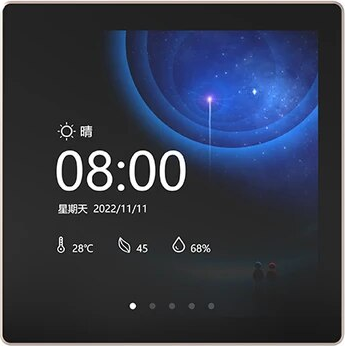
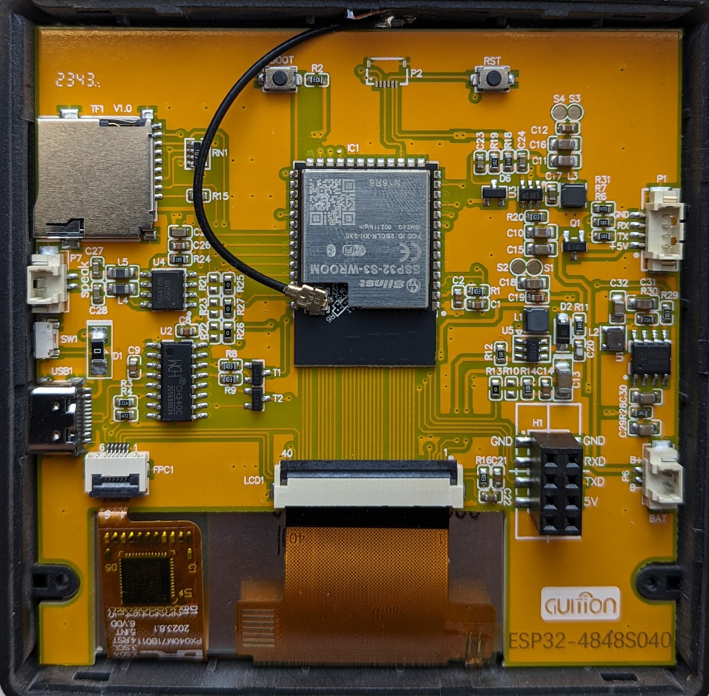

# Hardware overview: ESP32-4848S040C_I

Maker: Guition (sold under the Sunton/JCZN name). The silkscreen reads `ESP32-4848S040`, and the PCB shown is V1.0 from late 2023.

## Naming
`ESP32-4848S040C_I`
- `4848`: 480×480 resolution
- `S`: ESP32-**S**3
- `040`: 4.0" diagonal
- `C`: **C**apacitive touch (N = no touch, R = resistive)
- `_I` / `_Y`: housing and options variant. Some listings use `_I` for the plain version and `_Y` for the 86-box version with relays and mains PSU. rzeldent's definitions name them `CIY1` (1 relay) and `CIY3` (3 relays). Check whether your unit has a relay board and a mains terminal block on the back.

## Main components
| Component | Part | Notes |
|---|---|---|
| Module | ESP32-S3-WROOM-1 **N16R8** | 16 MB QIO flash, 8 MB **octal** PSRAM. Use `memory_type = qio_opi`. |
| LCD | 4.0" IPS 480×480 | ST7701S, RGB565 parallel bus plus 3-wire SPI for config |
| Touch | GT911 (on the FPC) | I2C. RST and INT are not routed to the ESP32. |
| USB-UART | **CH340C** | USB-C to UART0 (GPIO43/44). T1/T2 transistors give auto-reset and boot. |
| Audio | NS4168 | I2S class-D mono amp, `Speak` JST connector (P7). Its pins are shared with the relays. |
| Storage | microSD (TF1) | SPI |
| Power | 5 V USB-C, `+5V` on P1/H1, `BAT` JST (P6) | Relay variants also have an onboard 110–240 V AC PSU. |

## Connectors (from the back-side photo)
| Ref | What | Pins |
|---|---|---|
| USB1 | USB-C | Power plus CH340C serial |
| P1 | JST 4-pin | GND, RX, TX, +5V (UART0) |
| H1 | 2×4 header | GND, GND, RXD, TXD, 5V… (to the relay/PSU daughterboard) |
| P6 `BAT` | JST 2-pin | B+ / B− |
| P7 `Speak` | JST 2-pin | Speaker out from NS4168 |
| SW1 | small JST | Unconfirmed |
| FPC1 | 6-pin FPC | Touch panel (SDA, SCL, RST, INT, VDD, GND) |
| LCD1 | 40-pin FPC | LCD panel |
| P2 | small FPC | Unconfirmed |
| BOOT / RST | Buttons | BOOT = GPIO0 |

## Photos

## Mains warning
On relay variants the PSU and relay board carry **mains voltage**. Don't have mains connected while USB is plugged in and the case is open.
