# 05 Tesla Powerwall 3 display

A live **Tesla Powerwall 3** energy monitor on the Guition ESP32-4848S040's 4" 480x480 touch screen, read straight from the **Powerwall gateway's local LAN API**. No Tesla cloud account, no server, no subscription. It shows solar, home battery, grid and house load in real time, plus today's totals, battery and grid health, weather, and a few sky and climate screens. Built with LVGL 9 on the ESP32-S3.

**Status:** `works on hw`. It has run on a real board against a real Powerwall 3 (gateway firmware 26.26.4). Other firmware versions and other Powerwall models have not been tried: see [limitations](#limitations-and-notes).

<table>
  <tr>
    <td align="center">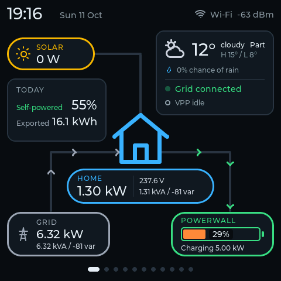<br>0 Power flow</td>
    <td align="center">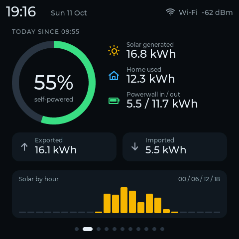<br>1 Today</td>
    <td align="center">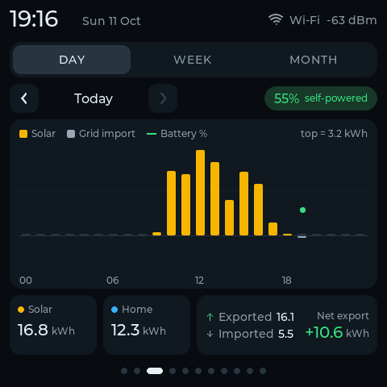<br>2 History (day)</td>
  </tr>
  <tr>
    <td align="center">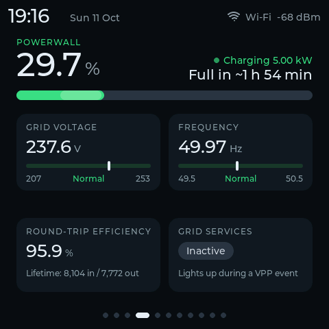<br>3 Battery and grid</td>
    <td align="center">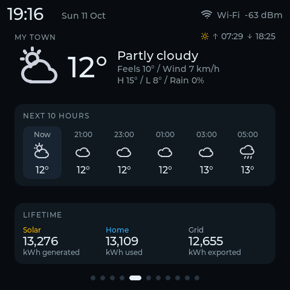<br>4 Weather</td>
    <td align="center">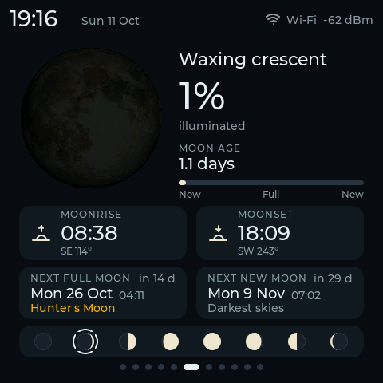<br>5 Moon</td>
  </tr>
  <tr>
    <td align="center">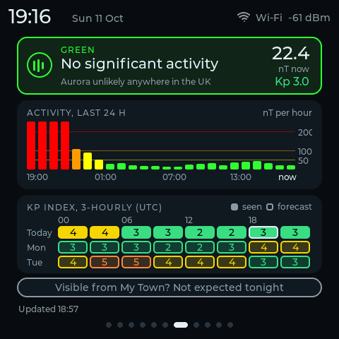<br>6 Aurora (UK)</td>
    <td align="center">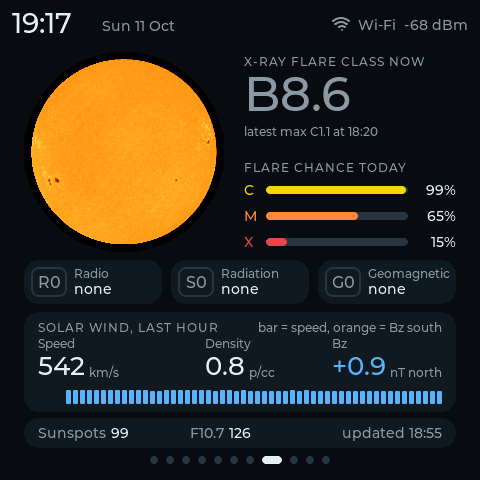<br>7 Sun and space weather</td>
    <td align="center">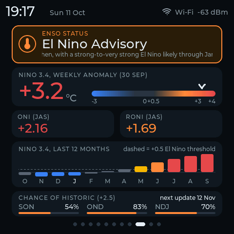<br>8 El Nino</td>
  </tr>
  <tr>
    <td align="center">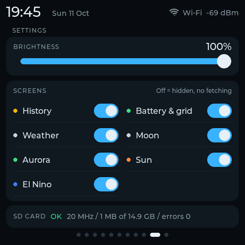<br>9 Settings</td>
    <td align="center">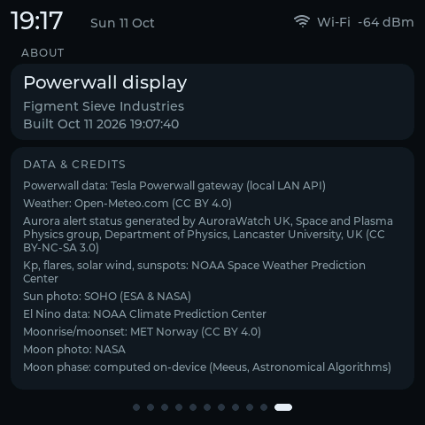<br>10 About</td>
    <td align="center">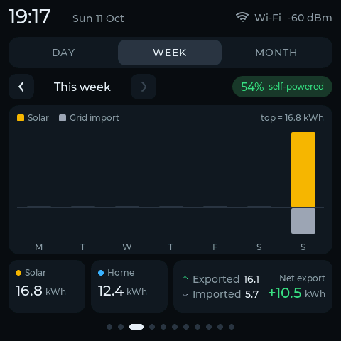<br>2 History (week)</td>
  </tr>
  <tr>
    <td align="center">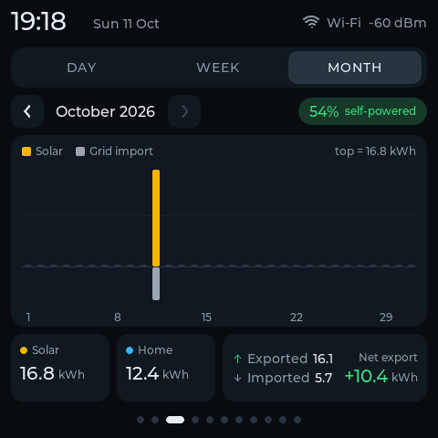<br>2 History (month)</td>
    <td></td>
    <td></td>
  </tr>
</table>

Screenshots are framebuffer captures from the board in privacy mode (placeholder Wi-Fi name and town).

## Contents

[What you need](#what-you-need) | [Set-up](#set-up) | [The screens](#the-screens) | [Data sources](#data-sources-and-refresh-intervals) | [SD card](#sd-card) | [Serial commands](#serial-commands) | [Screenshots](#screenshots) | [Troubleshooting](#troubleshooting) | [Limitations and notes](#limitations-and-notes) | [How it works](#how-it-works) | [Credits](#credits)

## What you need

- A **Tesla Powerwall 3** whose gateway is on your home network, and the **customer password** (see below).
- A **Guition ESP32-4848S040** (capacitive touch, the version without relays is the simple choice). Buying notes: [hardware and sourcing](../../docs/guide/06-hardware-and-sourcing.md).
- A **2.4 GHz Wi-Fi network** that can reach the gateway. The ESP32-S3 does not do 5 GHz. If the gateway is on a separate VLAN or Wi-Fi network, the board's network must be able to route to it.
- A USB-C data cable and a computer with PlatformIO (Windows and PowerShell are what the helper scripts assume).
- A **microSD card** (optional): plain SDHC, 32 GB or less, FAT32. Without one the display still works; you lose the log, the power-cut-safe totals, the cache and the saved brightness. Card advice is in the sourcing page.

## Set-up

### 1. The gateway password

The display logs in as the gateway's `customer` user, the same access as the gateway's own web page. The **customer password is the last 5 characters of the gateway password printed on the QR sticker** (on the Powerwall or gateway, and on the paperwork). You need only those 5 characters.

This is a read-only login. The firmware only reads three endpoints and never changes any setting on the Powerwall.

### 2. Find the gateway's IP address

Look in your router's DHCP client list for the Powerwall or gateway, then **give it a DHCP reservation** so the address does not change. The examples here use the documentation address `192.0.2.50`; yours will differ. If it is not in the list, it may be on another network segment (some home networks put IoT devices on a VLAN).

### 3. Configure `src/secrets.h`

Copy `src/secrets.example.h` to `src/secrets.h`. The file is git-ignored; never commit it.

```cpp
// Any number of networks; the strongest in range is joined. 2.4 GHz only.
static const WifiCred WIFI_NETWORKS[] = {
    {"My<home-ssid>", "password1"},
};

#define PW_HOST "192.0.2.50"            // the gateway's LAN IP
#define PW_CUSTOMER_PASSWORD "XXXXX"    // last 5 characters of the gateway password

#define TZ_INFO "GMT0BST,M3.5.0/1,M10.5.0"  // POSIX TZ string for the clock (UK shown)

#define WEATHER_LAT 51.5072             // Open-Meteo, no API key
#define WEATHER_LON (-0.1276)           // keep the brackets around a negative value
#define WEATHER_NAME "LONDON"           // shown on the weather screen
```

| Setting | Notes |
|---|---|
| `WIFI_NETWORKS` | Any number of networks (`WiFiMulti` joins the strongest and switches if it drops). If none is found, the board prints a scan of every visible network to serial. |
| `PW_HOST`, `PW_CUSTOMER_PASSWORD` | Gateway address and the 5-character password. A wrong password shows "login rejected - check password" and retries with growing delays (30 s up to 5 min). |
| `TZ_INFO` | A POSIX time-zone string, for example `CET-1CEST,M3.5.0,M10.5.0` for central Europe. Used for the clock, the date, the midnight rollover of today's totals and the daily log file. |
| `WEATHER_LAT`, `WEATHER_LON`, `WEATHER_NAME` | Your location for the weather, moon rise and set, and the "visible from ..." line on the aurora screen. The coordinates are sent to Open-Meteo and MET Norway with each request, and they identify your home, which is why they live in the git-ignored file. Your Powerwall readings are never sent anywhere. |

The aurora and El Nino screens are UK-oriented (AuroraWatch UK) and global (NOAA) respectively. Outside the UK the aurora alert level is still the UK one.

### 4. Build and flash

From PowerShell at the repository root (not Git Bash). Back up the factory flash first if you have not already (`.\tools\backup-flash.ps1`).

```powershell
.\tools\pio.ps1 05-powerwall-display all -Port COM5
```

`all` builds, uploads and opens the serial monitor (115200 baud). Use `build` to compile only. The first build downloads the toolchain and takes several minutes.

`SCREEN_ROTATION` in `src/main.cpp` defaults to `3` (90 degrees counter-clockwise, USB-C port at the bottom). Touch follows the rotation.

## The screens

Swipe left and right. The page dots at the bottom show where you are.

| # | Screen | Shows |
|---|---|---|
| 0 | **Power flow** | A house in the centre with chevrons that run along each link in the direction power flows, faster for more power. Solar, Grid and Powerwall pills with live values; the Powerwall pill has a state-of-charge bar and "Charging", "Discharging" or "Idle". Chips for home voltage (amber outside 207-253 V), VA and var, and grid direction ("Importing" or "Exporting"). A card with the weather (temperature, condition, high and low, rain chance), the grid status (a red **OFF-GRID** banner in an outage) and a VPP row. A "Today" card with self-powered share and energy exported. Top bar: clock, date, Wi-Fi network and signal. |
| 1 | **Today** | Self-powered percentage ring; solar, home and Powerwall energy in and out in kWh; exported and imported tiles; solar by hour. |
| 2 | **History** | Energy per hour (Day), per day of the week (Week, Monday first) or per day of the month (Month). DAY / WEEK / MONTH tabs, a stepper to go back through earlier periods (the forward button is dimmed at the current one), and a self-powered pill for the period. The chart has solar bars up, grid import bars down, and on Day a line of battery percentage at the end of each hour. Tap a bar for its readout. Solar, Home and Grid tiles below show the period totals, with net export or import. Today comes from the live readings; earlier days come from the SD card (see [SD card](#sd-card)), so without a card only today shows. |
| 3 | **Battery and grid** | State of charge, charge or discharge power and time to full or empty, grid voltage and frequency with normal-range markers, lifetime round-trip efficiency, and a grid-services (VPP) badge. |
| 4 | **Weather** | Current conditions (feels-like, wind, high and low, rain chance), today's sunrise and sunset times (top right), the next 10 hours in 2-hour steps, and lifetime energy totals. |
| 5 | **Moon** | A photograph of the full moon shaded on the device to the current phase, with phase name, illumination, age, moonrise and moonset, next full and new moon, and an eight-step phase strip. |
| 6 | **Aurora (UK)** | The AuroraWatch UK alert level, the last 24 hours of activity, and a three-day Kp strip (seen and forecast). |
| 7 | **Sun and space weather** | A live photo of the Sun from SOHO, X-ray flare class and odds, NOAA R/S/G scales, solar wind, sunspot number and F10.7 flux. |
| 8 | **El Nino (ENSO)** | The NOAA CPC status, weekly Nino 3.4 and its anomaly, ONI and RONI, 12 months of history and the outlook odds. |
| 9 | **Settings** | Backlight brightness slider, 0 to 100 % on a gamma curve (0 % is the dimmest level that is still lit). **Screens** switches for History, Battery & grid, Weather, Moon, Aurora, Sun and El Nino (power flow, Today, Settings and About are always on): a screen that is off is skipped when swiping, drops out of the page dots and stops its fetches (Moon: MET Norway moon times; Aurora: AuroraWatch + Kp; Sun: SWPC + the SOHO image; El Nino: CPC). Weather keeps fetching because the power-flow screen's weather card uses it, and history logging keeps running. Objects of an off screen stay allocated until the next restart. One-line SD card status (clock, space, errors). Brightness and screens are saved on the SD card (`settings.bin`, format SET3; SET1/SET2 files still load). |
| 10 | **About** | The firmware name and the data credits for every source the device uses. |

If gateway data is more than 20 seconds old the values show `--`, and a short error message appears below the page dots. Weather older than an hour is shown as stale.

The code is in `src/screen_*.cpp` behind `screens.h`, with the shared palette, top bar and animations in `ui_common.*` and the drawn icons in `icons.*`.

## Data sources and refresh intervals

| Data | Source | Refresh |
|---|---|---|
| Power, battery, grid, voltage | Powerwall gateway, local LAN API | Every 2 s, over one kept-alive HTTPS connection |
| Weather and 10-hour forecast | [Open-Meteo](https://open-meteo.com/) | 15 min |
| Aurora alert and 24 h activity | [AuroraWatch UK](https://aurorawatch.lancs.ac.uk/) | 30 min |
| Kp index and forecast | NOAA SWPC | 30 min |
| Flares, solar wind, scales, sunspots | NOAA SWPC | 30 min |
| Moonrise and moonset | MET Norway | Once per local day (checked every 30 min) |
| Moon phase | Computed on the device (Meeus) | Continuous |
| Sun photo | SOHO (ESA and NASA) | 1 h |
| El Nino (ENSO) | NOAA CPC | 12 h |

All of this runs on one network task, one HTTPS session at a time. Failed background fetches retry sooner than their normal period. Each fetch pins the root certificate of its host, sends an identifying User-Agent and has a 12-second time budget so that it cannot make the live power data stale. Terms and licences of each source: [sources and credits](../../docs/guide/99-sources-and-credits.md).

**What the gateway is asked for** (firmware 26.26.4, customer login, read-only):

| Call | Returns |
|---|---|
| `POST /api/login/Basic` | A token, sent back as `Authorization: Bearer <token>` |
| `GET /api/meters/aggregates` | Site, battery, load and solar `instant_power`, voltage, frequency, reactive and apparent power, lifetime counters (chunked response) |
| `GET /api/system_status/soe` | State of charge percentage |
| `GET /api/system_status/grid_status` | `SystemGridConnected` or islanded, and the grid-services flag |

No token gives 403 and an expired token gives 401; either way the display logs in again by itself. Sign conventions: grid above 0 is importing, battery above 0 is discharging.

## SD card

Optional, and recommended. The card is mounted after the display starts, checked every couple of seconds, and can be removed and inserted while running. The firmware never formats a card. Nothing is written to the board's internal flash while it runs, so the SD card is the only place history can live.

| What | Where | Notes |
|---|---|---|
| Minute log | `/powerwall/YYYY-MM-DD.csv` | One file per local day, one row per minute averaged from the 2-second readings |
| Daily history | `/powerwall/days/YYYY-MM.bin` | One file per month for the history screen. Raw, no header: 31 fixed slots (day of month minus 1) of 448 bytes each (13,888 bytes), each slot holding the day's totals (solar, home, export, import, battery in and out) and 24 hourly bins, with its own CRC, so a damaged slot loses only that day. Today's record is kept in RTC memory and saved every 10 minutes, on the hour and at midnight. A file is replaced by writing `.tmp` whole, then remove and rename; if power is cut between the two, the complete `.tmp` is used |
| Today's totals backup | On the card, written atomically | Today's totals survive a power cut and a reboot; the baseline is restored at start-up |
| Data cache | `/powerwall/cache/<name>.bin` | Weather, aurora, Kp, moon times, space weather, sun image, El Nino. After a reboot the screens fill at once and a fetch still inside its refresh window is skipped. Each record has a CRC; a bad or old-format record is ignored and refetched |
| Settings | `settings.bin` on the card | Brightness (percent) and the screen on/off mask, format SET3; older SET1 / SET2 files still load (every screen on) |

CSV columns (header row `time,solar_w,home_w,grid_w,battery_w,soc_pct,voltage_v,grid_up`):

| Column | Meaning |
|---|---|
| `time` | Local time of the minute, `YYYY-MM-DD HH:MM` |
| `solar_w` | Solar power, W |
| `home_w` | House load, W |
| `grid_w` | Grid power, W; positive is importing |
| `battery_w` | Battery power, W; positive is discharging |
| `soc_pct` | State of charge, percent |
| `voltage_v` | Site voltage, V |
| `grid_up` | `1` grid connected, `0` off-grid |

Without a card, "today" totals come from the gateway's lifetime counters minus a snapshot taken at midnight, kept in RTC memory. That survives a software restart or crash but not a power cut, the reset button or a reflash; after one the screen says "TODAY SINCE HH:MM" until the next midnight.

## Serial commands

Type a line into the serial monitor (115200 baud) to drive the display without touching it. Each command gets one reply line ending in `#ok` or `#err <reason>`. Commands are read without blocking, so the display keeps running. The source of truth is the comment block at the top of `src/main.cpp`.

| Command | Does |
|---|---|
| `s <n>` | Go to screen `n` (0 to 10) the way a swipe does; `#err screen disabled` if that screen is switched off in Settings |
| `n` / `p` | Next / previous enabled screen (wraps) |
| `l` | List the screens, the current one marked `*` |
| `b <0-255>` | Set the backlight now over the current duty range (not saved; the panel driver cuts out below about 100/255) |
| `bf <hz>` | Backlight PWM frequency, 100 to 1000000 Hz (not saved). Keeps the brightness and uses the highest duty resolution that frequency allows (8 bits at 100 kHz, 10 bits at 20 to 25 kHz). Replies with the same line as `br` |
| `bd <duty>` | Raw backlight duty at the current resolution, 0 to the maximum shown by `br` (not saved) |
| `br` | Report the backlight: `backlight 100000 Hz, 8 bits, duty 255 of 255, assumed minimum 100 #ok` |
| `bs [steps [ms [from [to]]]]` | Watch-the-panel sweep: steps the raw duty from `from` to `to` (default 0 to the maximum) in `steps` steps (default 16, 2 to 256), `ms` apart (default 1000, 100 to 10000), printing `bs i/n duty D @ F Hz` per step. Runs in the background; `bs 0` or any `b`, `bd` or `bf` stops it. The brightness setting comes back at the end (`bs done ... #ok`) |
| `e [<n> <0\|1>]` | Screens on/off: `e` lists the mask, `e 5 0` turns screen 5 off (same as the Settings switch, saved). Always-on screens answer `#err screen can't be disabled`; `s <n>` to an off screen answers `#err screen disabled`; `l` marks off screens with `-` |
| `y s <1..50>` | Diagnostic: save today's history record n times in a row, logging the panel CS pin (GPIO39) around each save (panel-drift investigation, see guide 03 `inv-panel-drift`) |
| `y [d\|w\|m\|-\|+]` | History screen: `d`, `w`, `m` pick the Day, Week or Month tab, `-` and `+` step to the previous or next period; no argument just describes what the screen shows. Every form also prints the day-history store status (records saved, loaded, errors) |
| `m` | Print the memory and heap line |
| `x` | Screenshot: the framebuffer as base64 lines at 921600 baud (used by `screendump.py`) |
| `v <0\|1>` | Privacy mode for screenshots: placeholder Wi-Fi name and town (not saved) |
| `c` | List the SD cache records (name, size, version, age) |
| `k` | Diagnostic: force an RGB scan-out restart at the next VSYNC (panel drift, see guide 03 `inv-panel-drift`) |
| `r` | Reboot (RTC data and the clock survive) |
| `h` | Help |

A heartbeat line is printed every 10 seconds with frame rate, memory, stack headroom, network counters and SD state. Use `PW_GW_KEEPALIVE` (see `powerwall.h`) to switch the gateway connection back to one handshake per poll if your gateway misbehaves with keep-alive; the default is on.

## Screenshots

`tools-dev/screendump.py` takes a framebuffer screenshot over serial and writes a PNG without third-party imaging libraries. It needs pyserial, which PlatformIO's Python has. Close the serial monitor first: the port cannot be shared.

```powershell
$py = "$env:USERPROFILE\.platformio\penv\Scripts\python.exe"
& $py projects\05-powerwall-display\tools-dev\screendump.py COM5 shot.png                  # current screen
& $py projects\05-powerwall-display\tools-dev\screendump.py COM5 shot.png --screen 3       # go to screen 3 first
& $py projects\05-powerwall-display\tools-dev\screendump.py COM5 screens --all --privacy   # every screen, placeholder Wi-Fi name and town
```

With `--all` the output argument is a prefix and the files are named `<prefix>-<n>-<name>.png`. Use `--privacy` for anything you intend to publish. A screenshot shows the framebuffer, so it cannot show tearing.

## Troubleshooting

| You see | Likely cause and first step |
|---|---|
| "login rejected - check password" | The 5-character customer password is wrong. Re-read the end of the gateway password on the sticker. Failed logins back off, so fix `secrets.h`, reflash and wait for the next attempt |
| `--` everywhere, an error under the page dots | The gateway is unreachable or not answering. Check `PW_HOST`, the DHCP reservation, and that the board's Wi-Fi network can route to the gateway |
| No network found, a scan listed on serial | The SSID is mistyped or only on 5 GHz. The ESP32-S3 needs 2.4 GHz |
| Occasional gateway handshake refusals in the log | The gateway limits how often it accepts new TLS handshakes. Keep-alive (the default) cuts these sharply |
| Blank or flickering display, build failures, upload fails, SD card problems | See the [quirks catalogue](../../docs/guide/01-quirks-and-gotchas.md) and the [debugging playbook](../../docs/guide/02-debugging-playbook.md). Power gateway entries are the Q-PW series |
| Time wrong | Check `TZ_INFO`. The clock is set over NTP, so the board needs internet access for time (and for the weather and space data); the Powerwall data itself is local |

The guide also holds the write-ups behind the design choices: [investigations](../../docs/guide/03-investigations.md) and [patterns and decisions](../../docs/guide/04-patterns-and-decisions.md).

## Limitations and notes

- **The gateway API is unofficial.** Tesla does not publish or support it, and it can change with any firmware update. It was tested against **Powerwall 3, firmware 26.26.4** only. Powerwall 2 and other firmware versions are untested.
- **Only three endpoints answer** on the customer login. Backup reserve, operating mode, per-string solar, alerts and temperatures are not available; they would need a different, more privileged access that this project does not use.
- **Battery percentage** matches the Tesla app: the gateway's raw value includes a 5 percent reserve that the app hides, so the display shows `(raw - 5) / 0.95`. Build with `-DPW_SOC_APP_SCALE=0` to show the raw value. This scaling has not been compared against the app on every state of charge.
- **Capacity** used for time to full or empty is assumed to be 13.5 kWh per unit; override with `-DPW_CAPACITY_KWH=<kWh>`.
- **VPP / grid services:** the "VPP event active" state has not been seen on a real event.
- **Aurora data is UK-specific.** AuroraWatch UK and the "visible from" hint are for the UK.
- **Non-commercial data.** Open-Meteo's free API and AuroraWatch UK's data are for non-commercial use. See the credits before building anything commercial.
- **Not affiliated with Tesla.** Tesla and Powerwall are trademarks of Tesla, Inc.
- **Nothing is written to internal flash at runtime**, to avoid wear. Settings and history go to the SD card.
- **Memory:** LVGL uses its own 1 MB pool in PSRAM, and about 100 KB of internal RAM is kept free for TLS. Do not enable `LV_ATTRIBUTE_FAST_MEM` in this project; the reasons are in the [patterns chapter](../../docs/guide/04-patterns-and-decisions.md).
- **Wi-Fi credentials and your location live only in `src/secrets.h`**, which is git-ignored. Do not paste the gateway address, password or token into issues.

## How it works

One network task on core 0 (`powerwall.cpp`) polls the gateway every 2 seconds and runs at most one due background fetch (weather, aurora, Kp, moon times, space weather, sun image, El Nino) per pass, one TLS session at a time. LVGL runs on core 1 only. They share data through mutex-protected snapshots. `energy.cpp` keeps today's totals in RTC memory, and `history.cpp` owns all SD card access in one low-priority task. `cache.cpp` stores the fetched data on the card. `day_history.cpp` builds today's hourly record from the gateway's lifetime counters (RTC memory) and, on the SD task, saves it into the month files and keeps a three-month cache in PSRAM; the UI only reads that cache, never the card.

Host-side tests of the parsers, the HTTP body reader and the cache run on a PC without a board: `.\projects\05-powerwall-display\hosttest\run.ps1` (see [`hosttest/README.md`](hosttest/README.md)). The moon image data is rebuilt by [`tools-moon/`](tools-moon/README.md).

## Credits

Data sources, libraries and licences: [docs/guide/99-sources-and-credits.md](../../docs/guide/99-sources-and-credits.md). The About screen on the device shows the short form of the data credits. Tesla and Powerwall are trademarks of Tesla, Inc.; this project is unofficial. Made by Figment Sieve Industries, developed with Claude (Anthropic) as a coding assistant.
